# Arquitectura del sistema educativo de iluminación hotelera

## 1. Propósito

Este documento define la arquitectura conceptual de un sistema educativo para analizar la iluminación de un hotel de dos torres en Bogotá. El sistema aplica árboles jerárquicos, un Octree, un grafo dirigido ponderado, una cola de prioridad, un árbol AVL, un árbol rojo-negro y recorridos de agregación para estudiar cuatro actividades: habitaciones, cocina, recreación y parqueadero.

El modelo cubre 24 horas con un único flujo de simulación. Durante el día combina la posición real del sol en Bogotá, luz natural, transmisión por ventanas, reflexión y luz artificial complementaria. Durante la noche toma la componente solar como cero y utiliza principalmente las luminarias alimentadas por el generador. El resultado es un diagnóstico educativo, no un diseño fotométrico, eléctrico o arquitectónico profesional.

## 2. Decisiones arquitectónicas

### 2.1 Escenario fijo y reproducible

El hotel contiene exactamente dos torres, identificadas como `TP` (Torre Pequeña) y `TG` (Torre Grande):

```text
Hotel
├── TP (Torre Pequeña): 4 pisos, 32 habitaciones, 4 cocinas, 4 recreaciones, 1 parqueadero
└── TG (Torre Grande): 6 pisos, 72 habitaciones, 6 cocinas, 6 recreaciones, 2 parqueaderos
```

Las áreas de referencia son aproximadamente 4.013 m² y 11.346 m², inspiradas en modelos comerciales del DOE. Las cajas, posiciones, zonas, luminarias y huéspedes son datos sintéticos didácticos; no son un plano real de Bogotá.

La caja de `TP` es `x=0..32, y=0..31.35, z=0..12`. La caja de `TG` es `x=45..89, y=0..43, z=0..18`. Cada piso tiene 3 m de altura y la separación horizontal entre torres es de 13 m.

### 2.2 Un árbol físico y estructuras auxiliares

```text
Árbol jerárquico:
    Hotel → Torre → Piso → ZonaHotel → Ventana / SuperficiePared
    Torre → Fachada (4 por torre: N, S, E, O)

Octree:
    cajas de torres, fachadas, paredes, ventanas y luminarias

Grafo de influencia:
    Fachada → Ventana de la otra torre, con aristas indexadas por origen y por destino

Cola de prioridad (heapq):
    demandas de energía de cada instante

AVL:
    habitaciones HABITABLE con cama libre, clave (torre, piso, −calidad, id)

Rojo-negro:
    resultados de la simulación, clave (hora, zona_id)
```

El árbol representa composición física y lógica. El Octree sólo acelera consultas espaciales: rayos para las sombras y radios para construir el grafo. El grafo representa aportes lumínicos aproximados y no reemplaza la jerarquía. El AVL y el rojo-negro son índices sobre datos que ya calculó la simulación: el AVL sirve a la reasignación y el rojo-negro a las consultas por franja horaria.

### 2.3 Modelo único de día y noche

No se crean clases `ResultadoDiurno` ni `ResultadoNocturno`. Las mismas clases `ZonaHotel`, `PerfilIluminacion` y `ResultadoIluminacion`, y los módulos de habitabilidad y de balance, reciben el instante y el modo de operación.

```text
E_total(z,t) = E_natural(z,t) + E_reflejada(z,t) + E_artificial(z,t)

Día:   E_natural + E_reflejada + E_artificial
Noche: 0 + 0 + E_artificial
```

Los modos son `ACTIVA`, `REDUCIDA`, `CERRADA` y `EMERGENCIA`. El modo sale del horario de cada actividad, y la franja activa manda sobre la de cierre. La cocina cierra de 23:00 a 05:00 y la recreación de 00:00 a 07:00; las habitaciones y el parqueadero nunca cierran. Un paso `CERRADA` no consume energía y no cuenta en el puntaje de habitabilidad. Una habitación en descanso se compara con un nivel reducido configurable (por defecto 30 % del perfil activo), no con el perfil de habitación activa.

`EMERGENCIA` lo asigna el balance. Primero se reserva un nivel de emergencia de 10 lux para todas las zonas abiertas. La zona que no alcanza su mínimo porque el generador se agotó queda en `EMERGENCIA`, se clasifica contra el mínimo de su modo de horario y ese paso cuenta como déficit.

### 2.4 Geometría fija, variables de luz ajustables

La geometría de las torres es fija. El sistema no mueve ni rediseña edificios, no agrega torres y no cambia la capacidad del hotel. Sí mide mejoras y propone reestructuraciones de las variables de luz: orientación de ventanas, acabados (pared y vidrio), luminarias por recinto, horarios y generador.

- **Mejoras medidas.** Salen de los problemas del escenario. Para las zonas `CASI_HABITABLE` o `NO_HABITABLE` se elige un cambio según la causa: `VIDRIO_CONTROL_SOLAR` en las zonas con causa `EXCESO_SOLAR` (por zona, en `zonas_personalizadas`); `REPONER_LUMINARIAS` en las zonas con déficit cuyo `luminaria_w` está por debajo de la potencia de su actividad, que la recuperan; `AMPLIAR_GENERADOR` sólo si alguna media hora quedó en `EMERGENCIA`, con capacidad nueva = máx(1,2 × demanda objetivo máxima redondeada hacia arriba a 0,1 kW; 1,2 × capacidad actual); y `VIDRIO_CLARO` y `PAREDES_BLANCAS` en las zonas con causa `DEFICIT_DIURNO` que aún no los tienen. Cada candidata se simula completa y sólo se muestran las que suben el puntaje del hotel. Si no hay zonas con problemas, el resultado es `TODO_HABITABLE`: no hace falta ninguna mejora.
- **Reestructuración.** Búsqueda por coordenadas sobre paredes, vidrios, orientaciones de ventanas y horarios (cocina y recreación) de las actividades que tienen zonas `CASI_HABITABLE` o `NO_HABITABLE`. No cambia los objetivos de lux. Prueba un cambio a la vez dentro de rangos fijos, con un presupuesto de 30 evaluaciones y hasta 3 rondas, y conserva el que mejora el puntaje ponderado (desempate: menos zonas no habitables y luego menos energía).

Los resultados son propuestas. La propuesta de reestructuración se puede cargar en los formularios, pero el sistema no la aplica por su cuenta. El balance de energía y la reasignación de huéspedes son heurísticos. Una reasignación propone cambiar una relación `Huesped–HabitacionHotel`; no mueve físicamente al huésped ni modifica la geometría.

### 2.5 Interfaz web y pruebas

La interfaz web (`web/`, servida con `python -m src.api`) se organiza en seis pestañas: configurar, diagnóstico, plano por torre y piso con selector de franja horaria, balance, mejoras (mejoras medidas y reestructuración) y detalle técnico (estructuras de datos con sus conteos de comparaciones y rotaciones, en tablas plegables con una explicación cada una). Tiene modo oscuro y claro.

- **Diagnóstico** empieza con una sección plegable «Cómo leer los resultados»: los estados en palabras simples, la escala 0,75 / 0,90, la regla del 5 % de oscuridad y la tabla de lux por actividad. El veredicto no repite la lista de zonas casi habitables; esa lista está en las tarjetas de sugerencias. Los IDs de zona en sugerencias, mejoras y reasignaciones son enlaces que abren el plano con esa zona seleccionada.
- **Plano** muestra arriba las tres leyendas (separación de espacios, habitabilidad y confort lumínico) y las abreviaturas TP/TG, y marca la capa activa. En el detalle de una zona, «Aplicar y simular» aplica el cambio a esa zona y vuelve a ejecutar la simulación y el balance. La gráfica del día muestra el puntaje de cada franja (madrugada, mañana, tarde, noche y cierre) y explica que antes del balance la noche no se evalúa.
- **Balance, Mejoras y Detalle técnico** muestran el botón «Balancear energía ahora» mientras no se haya hecho el primer balance.

`python -m unittest` ejecuta 26 pruebas: los 10 casos de prueba del Plan y los diez escenarios de `data/casos_prueba/`, cada uno con su historia y su resultado esperado, más comprobaciones comunes a los casos.

## 3. Datos sintéticos comunes

| Elemento | TP | TG | Regla común |
|---|---:|---:|---|
| Pisos | 4 | 6 | 3 m por piso |
| Habitaciones | 32 | 72 | 24 m², capacidad 2 |
| Cocinas | 4 | 6 | 35 m² |
| Recreaciones | 4 | 6 | 80 m² |
| Parqueaderos | 1 | 2 | 450 m² |
| Habitaciones ocupadas | 24 | 54 | 78 huéspedes en total |
| Ventanas | 52 | 102 | Habitaciones 1, cocinas 2, recreaciones 3 |

Cada habitación tiene una ventana de 2,0 m²; cada cocina tiene dos de 1,5 m² y cada recreación tres de 2,0 m². Los IDs de zona combinan torre, actividad y número, por ejemplo `TP-H-101` (habitación) y `TG-COC-01` (cocina); los huéspedes van de `H-001` a `H-078`. Las orientaciones de habitaciones alternan norte, este, sur y oeste.

Las luminarias equivalentes por zona son: habitación 72 W, cocina 200 W, recreación 450 W y parqueadero 720 W. Un recinto puede cambiar la suya con `luminaria_w` en `zonas_personalizadas` (un número ≥ 0; 0 representa una luminaria dañada). Ese campo se valida al cargar y solo se edita en el JSON, no desde la interfaz. Todas usan, como supuesto didáctico, 100 lm/W, `CU=0,70` y `MF=0,80`. El generador nominal es de 22,0 kW y sólo alimenta iluminación.

| Actividad | Horario sintético | Perfil activo | Prioridad |
|---|---|---:|---:|
| Habitación | 06:00–22:00 activa; resto reducida | 100–200–300 lux | 3 |
| Cocina | 06:00–22:00 activa; 23:00–05:00 cerrada; resto reducida | 300–400–500 lux | 3 |
| Recreación | 08:00–23:00 activa; 00:00–07:00 cerrada; resto reducida | 200–300–500 lux | 2 |
| Parqueadero | 00:00–24:00 activa | 50–100–150 lux | 1 |

Los tripletes significan mínimo–objetivo–máximo. Son presets de cálculo, no valores normativos textuales.

## 4. Contraste con RETILAP

La página oficial del Ministerio de Minas y Energía informa que el RETILAP vigente fue modificado por la Resolución 40286 del 23 de junio de 2026 y que está organizado en cuatro libros. La misma página describe una herramienta de apoyo para habitaciones, cocinas y otras áreas, pero no presenta una tabla única que permita afirmar que los cuatro tripletes anteriores sean una transcripción normativa directa.

Por ello, la arquitectura adopta esta regla: los rangos sirven para el escenario educativo y deben confirmarse en el diseño final contra la categoría exacta de actividad, plano de trabajo, uniformidad, deslumbramiento y mantenimiento. El modo `EMERGENCIA` tiene un parámetro independiente y no se deduce de los rangos normales. Fuente oficial: [RETILAP, Ministerio de Minas y Energía](https://www.minenergia.gov.co/es/misional/energia-electrica-2/reglamentos-tecnicos/reglamento-t%C3%A9cnico-de-iluminaci%C3%B3n-y-alumbrado-p%C3%BAblico-retilap/).

## 5. Clases del dominio

### `Hotel`

Contiene exactamente dos `Torre`, un `GeneradorEnergia`, perfiles de iluminación y climáticos, horarios, fuentes, huéspedes y asignaciones. Indexa zonas y habitaciones por ID.

### `Torre`

Mantiene ID (`TP` o `TG`), nombre de presentación ("Torre Pequeña", "Torre Grande"), caja espacial, área de referencia, pisos y cuatro fachadas. Sus dimensiones son fijas.

### `Fachada`

Cara exterior de una torre (`NORTE`, `SUR`, `ESTE` u `OESTE`). Mantiene ID (por ejemplo `TP-F-ESTE`), torre, lado, normal, reflectancia, caja (plana, del alto de la torre) y área. La reflectancia sale del campo `fachada` de cada torre en el JSON; si falta, se usa `GRIS_CLARO` (0,60). Es el origen de las aristas del grafo de influencia.

### `Piso`

Mantiene número, peso `1 + 0,10(p-1)` y zonas del piso.

### `ZonaHotel`

Mantiene ID, actividad, área, piso, torre, modo, ventanas, superficies, luminaria y resultados temporales. El perfil de iluminación se toma del hotel según la actividad. Puede representar una `HabitacionHotel`, cocina, recreación o parqueadero.

### `HabitacionHotel`, `Huesped` y `Asignacion`

`HabitacionHotel` agrega capacidad, ocupación y disponibilidad (hay cama libre si la ocupación es menor que la capacidad). `Huesped` agrega actividad, prioridad y restricciones: `MISMA_TORRE`, `PISO_MAXIMO:n` y `ORIENTACION:ESTE|NORTE|OESTE|SUR`. `Asignacion` relaciona huésped y habitación; una propuesta de reasignación sugiere cambiarla, pero no la modifica.

### `Ventana`, `Vidrio` y `SuperficiePared`

Una ventana mantiene posición, normal, área y vidrio. El vidrio mantiene tipo, transmitancia visible e índice de refracción. Una pared mantiene posición, normal, caja y la reflectancia educativa de su preset de color. Esa reflectancia representa todas las superficies interiores del recinto en la reflexión interior.

### `FuenteIluminacion` y `GeneradorEnergia`

Una fuente mantiene posición, potencia máxima, eficacia, `CU`, `MF`, horario y zona servida. El generador mantiene capacidad, reserva, potencia disponible en cada instante y demanda objetivo máxima observada. El generador no modela cargas de habitaciones, ascensores o climatización.

### `PerfilClimatico`

Mantiene radiación, nubosidad y precipitación de Bogotá (NASA POWER), la radiación de cielo despejado de referencia, 7,063 kWh/m²/día, y el día del año `dia_del_anio` que fija la posición del sol: 46 (febrero) para nubes parciales y cielo despejado, 135 (mayo) para nublado y 105 (abril) para lluvioso. `factor_luz` es una propiedad calculada: `radiación / radiación de cielo despejado`, limitada a 1. Para los perfiles del escenario da 0,689 (nubes parciales), 0,634 (nublado), 0,631 (lluvioso) y 1,000 (despejado). La nubosidad y la precipitación son informativas y no entran en el cálculo.

### `Cielo`

Condición del cielo en una media hora (`clima.py`): luz global horizontal, fracción difusa, vector hacia el sol y reflectancia del suelo. Da la directa horizontal `G × (1 − kd)` y la difusa horizontal `G × kd`, que suman `G`.

## 6. Clases algorítmicas

| Clase o módulo | Responsabilidad |
|---|---|
| `Octree` | Consultar rayos y radios sobre torres, fachadas, paredes, ventanas y luminarias. |
| `GrafoInfluencia` | Mantener las aristas `fachada → ventana de la otra torre` (reflexión exterior de primer orden) por origen (`adyacencias`) y por destino (`entrantes`), la obstrucción del cielo de cada ventana (`obstruccion`) y los conteos de su construcción. |
| `PerfilClimatico` | Mantener radiación, nubosidad y precipitación, y calcular `factor_luz`. |
| `PerfilIluminacion` | Mantener mínimo, objetivo, máximo y prioridad, y dar el triplete de cada modo. |
| `SimuladorUnificado` | Ejecutar el mismo flujo entre 00:00 y 24:00 en pasos de 30 minutos. |
| `IndiceAVL` | Árbol AVL con inserción, eliminación, sucesor, siguiente y rango; cuenta rotaciones y comparaciones. |
| `IndiceRojoNegro` | Árbol rojo-negro con inserción y rango; cuenta rotaciones y comparaciones. |
| `IndiceTemporal` | Indexar cada resultado en el rojo-negro con clave `(hora, zona_id)` y responder consultas por franja. En la simulación principal también inserta en un AVL para comparar rotaciones. |
| Clima (`clima.py`) | Calcular la posición del sol, la luz global, la fracción difusa diaria y la luz directa y difusa sobre una superficie vertical; devolver un `Cielo` por instante. |
| Balance (`balance.py`) | Decidir el modo de cada zona, reservar emergencia, cubrir mínimos y distribuir la potencia restante con `heapq`. |
| `Reparto` (`balance.py`) | Llevar en `usado` la potencia que el generador ya entregó en el instante; `entregar(p)` da `min(p, capacidad − usado)` en O(1). |
| Habitabilidad (`habitabilidad.py`) | Puntuar cada zona y darle un veredicto. |
| Reasignación (`reasignacion.py`) | Buscar habitaciones habitables con cama libre en el AVL, respetando restricciones. |
| Mejoras y reestructuración | Volver a simular el escenario con cambios en las variables de luz y comparar puntajes. |

## 7. Reglas de cálculo

La posición del sol es la real de Bogotá (`direccion_solar`), con la hora tomada como hora solar:

```text
φ = 4,711° N                                  (parametros_evaluacion.ubicacion.latitud)
δ = 23,45° × sen(360° × (284 + n) / 365)      (Cooper, 1969; n = dia_del_anio del perfil)
ω = 15° × (hora − 12)
sol = (−cos δ sen ω,  sen δ cos φ − cos δ sen φ cos ω,  sen δ sen φ + cos δ cos φ cos ω)
      (este, norte, arriba)
```

En febrero (n = 46) el sol de mediodía está a 72,0° de altura y hacia el sur; a las 7:00 está a 13,4° y a las 9:00 a 41,8°. En abril (n = 105) el mediodía llega a 85,3°, y en mayo (n = 135) a 75,9°, hacia el norte.

La luz global sobre un plano horizontal sale de la radiación real:

```text
G(t)       = K_lux × factor_luz × max(0, sen(altura del sol))   entre 06:00 y 18:00; 0 fuera
factor_luz = radiación / radiación de cielo despejado
```

`K_lux` es 900. En febrero con nubes parciales, `G` vale 143,9 lux a las 7:00, 413,3 a las 9:00, 589,3 a las 12:00, 413,3 a las 15:00 y 66,8 a las 17:30.

`G` se reparte en directa y difusa con una fracción difusa diaria (Erbs, Klein y Duffie, 1982, forma para ωs > 81,4°):

```text
H0 = 24/π × Gsc × (1 + 0,033 cos(360n/365)) × (cos φ cos δ sen ωs + ωs sen φ sen δ)   Gsc = 1,367 kW/m²
KT = radiación / H0
kd = 1,311 − 3,022 KT + 3,427 KT² − 1,821 KT³
directa horizontal = G × (1 − kd)      difusa horizontal = G × kd
```

| Perfil | `H0` | `KT` | `kd` |
|---|---:|---:|---:|
| Nubes parciales | 10,05 | 0,484 | 0,445 |
| Nublado | 10,06 | 0,445 | 0,484 |
| Lluvioso | 10,41 | 0,428 | 0,503 |
| Cielo despejado | 10,05 | 0,703 | 0,248 |

Sobre una superficie vertical (ventana o fachada) se usa el cielo isotrópico de Liu y Jordan (1960):

```text
directa_vertical = directa horizontal × cos θ / max(sen(altura), sen 5°)     (factor Rb)
difusa_vertical  = 0,5 × difusa horizontal × (1 − obstrucción) + 0,5 × ρ_suelo × G
```

`θ` es el ángulo entre la normal de la superficie y el sol y `ρ_suelo = 0,20` (`parametros_evaluacion.luz.reflectancia_suelo`). La altura mínima de 5° evita que el factor se dispare al amanecer. En una ventana:

```text
E_ventana = VLT × (directa_vertical × F(θ) + difusa_vertical)
```

En la luz directa, cada ventana calcula el ángulo de refracción con Snell (`n = 1,5`) y la transmitancia de Fresnel no polarizada en las dos caras del vidrio. El resultado se normaliza con la incidencia perpendicular, así que a 0° se conserva la transmitancia visible del catálogo. La luz difusa usa directamente esa transmitancia visible. El vidrio usa una transmitancia visible de 0,82, 0,71 o 0,52 según el preset. Las paredes y las fachadas usan reflectancias educativas de 0,80, 0,70, 0,60, 0,45 o 0,25.

Si la otra torre le hace sombra a la ventana, `cos θ = 0` y no hay directa. La otra torre también tapa parte del cielo. La difusa del cielo de cada ventana se multiplica por `1 − obstrucción`, con `obstrucción = Σ cos_ventana × factor de vista` de las fachadas que la ventana tiene enfrente (máximo 1). En el escenario base 40 ventanas tienen obstrucción; `TP-H-101-V1` (al este, frente a TG) tiene 0,593.

La luz reflejada sólo existe de día y tiene dos partes:

```text
E_reflejada = E_exterior + E_ri

E_exterior(ventana) = Σ luz_fachada × peso × VLT
luz_fachada         = directa_vertical(n · sol) + difusa_vertical(sin obstrucción)
peso                = ρ_fachada × cos_fachada × cos_ventana × A_f / (π·d² + A_f)

E_ri  = Φ × ρ / (A_int × (1 − ρ))
Φ     = Σ_ventanas (E_natural + E_exterior) × área_ventana
A_int = 2 × área + 4 × √área × 3 m
```

- **Reflexión exterior entre torres.** Los orígenes son las 8 fachadas y los destinos, las ventanas de la otra torre. Cada ventana se lleva a su punto de salida en la fachada de su torre (`punto_en_fachada`); `consultar_radio` (18 m) entrega las fachadas candidatas; `d` es la distancia al punto más cercano de cada fachada; ventana y fachada deben mirarse y un rayo (`_visible`) debe llegar sin cruzar otra torre. El último factor del peso es un factor de vista aproximado para una superficie grande. La reflexión exterior es de primer orden. La zona toma el promedio de la exterior de sus ventanas.
- **Reflexión interior.** Método de flujo dividido con la reflectancia `ρ` de la pared del recinto. Promedia todos los rebotes interiores, así que no es de primer orden, y hace que el color de la pared cambie la luz de su propio cuarto. Una habitación de 24 m² tiene `A_int ≈ 106,8 m²`; con pared blanca (`ρ = 0,80`), `ρ / (1 − ρ) = 4`.

A las 12:00 de febrero el sol está al sur, así que las ventanas al este y al norte solo reciben difusa. En el escenario base, `TP-H-101` (ventana al este, frente a TG) recibe 92,0 lux naturales y 66,5 reflejados; `TP-H-102` (al norte, sin torre enfrente) recibe 155,8 naturales y 11,7 reflejados, casi todos interiores (con pared oscura la reflejada baja a 1,0); `TG-H-101` (al este, sin torre enfrente) recibe lo mismo que `TP-H-102`, 155,8 y 11,7. La fachada `TG-F-OESTE` recibe 133,2 lux a las 9:00, 190,0 a las 12:00 y 370,0 a las 15:00; su arista hacia `TP-H-101-V1` pesa 0,3559.

La luz artificial se aproxima con el método de lúmenes:

```text
E_artificial = eficacia × potenciaAsignada × CU × MF / área
```

El `CU = 0,70` del método de lúmenes ya incluye el rebote interior de la luz de la luminaria, por eso a la luz artificial no se le suma reflexión aparte. El `CU` es fijo y no cambia con el color de la pared.

El generador se dimensiona sólo para iluminación:

```text
P_generador = 1,20 × máximo_t(suma(P_obj(z,t)))
```

El balance de cada instante sigue este orden:

1. Reserva el nivel de emergencia (10 lux) para todas las zonas abiertas.
2. Cubre los mínimos: primero el parqueadero, como seguridad; luego las habitaciones ocupadas; luego el resto.
3. Reparte la potencia restante hacia los objetivos, por prioridad `pesoActividad × pesoPiso × factorOcupacion` (1,4 si la habitación está ocupada).

Las dos colas se ordenan con `heapq`. Cada entrega pasa por un `Reparto`, que guarda en `usado` lo que el generador ya entregó en el instante y no vuelve a sumar todo lo asignado; así cada entrega cuesta O(1) y el instante O(Z log Z). El peso no modifica el estado físico de una zona: una zona oscura sigue siendo deficitaria.

La clasificación por instante es:

```text
E < 0,50 mínimo       → DEFICIT_SEVERO
0,50 mínimo ≤ E < min → DEFICIT_LEVE
mínimo ≤ E ≤ máximo   → CONFORTABLE
máximo < E ≤ 1,25 max → EXCESO_LEVE
E > 1,25 máximo       → EXCESO_SEVERO
faltan datos           → DATOS_INSUFICIENTES
```

El veredicto de habitabilidad de cada zona usa el puntaje `P`, promedio de `q` en los pasos evaluables: `q = 1` si el paso es confortable, `0,5` si es déficit o exceso leve y `0` si es severo. Los pasos `CERRADA` y `DATOS_INSUFICIENTES` no cuentan.

| Veredicto | Condición |
|---|---|
| `HABITABLE` | `P ≥ 0,90` |
| `CASI_HABITABLE` | `0,75 ≤ P < 0,90` |
| `NO_HABITABLE` | `P < 0,75`, o más de 5 % de los pasos en déficit severo |

Un huésped se reasigna sólo si su habitación queda `NO_HABITABLE`. Las habitaciones `HABITABLE` con cama libre forman una bolsa en el AVL con clave `(torre, piso, −calidad, id)`, donde `calidad = w_luz × puntaje + w_energia × ahorro`. Para cada huésped se consulta el sucesor de cada piso permitido y se resta una penalización por cambio de piso. `MISMA_TORRE` y `PISO_MAXIMO:n` filtran pisos; `ORIENTACION:...` es una preferencia que suma `w_actividad` si coincide. Cuando una habitación se llena, se elimina del árbol, así que dos huéspedes no reciben la misma cama. Cada propuesta lista las habitaciones descartadas con su motivo; si no hay alternativa, el motivo es `SIN_HABITACIONES_HABITABLES_LIBRES`, `SIN_CAPACIDAD` o `RESTRICCIONES`.

El índice temporal responde, para cada franja (día completo, 00–06, 06–12, 12–18, 18–22 y 22–24): energía en kWh, energía por actividad y por torre, hora pico del generador, déficit residual, energía no asignada, zonas críticas y horas con déficit.

## 8. Diagrama de clases conceptual

El diagrama completo, con todos los campos y relaciones, está en `diagrama-clases-hotel.mmd`. Esta versión resume las clases principales con los mismos nombres.

```mermaid
classDiagram
    class Hotel { +id +torres[2] +generador +perfiles_climaticos +huespedes +asignaciones }
    class Torre { +id +nombre +area_referencia +caja +pisos +fachadas }
    class Fachada { +id +torre_id +lado +normal +reflectancia +caja +area }
    class Piso { +numero +zonas +peso }
    class ZonaHotel { +id +actividad +area +modo +ventanas +superficies +resultados }
    class HabitacionHotel { +capacidad +ocupacion +disponible }
    class Ventana { +posicion +normal +area +vidrio }
    class Vidrio { +transmitancia_visible +indice_refraccion }
    class SuperficiePared { +posicion +normal +reflectancia }
    class FuenteIluminacion { +potencia_maxima +eficacia +cu +mf +hora_inicio +hora_fin }
    class GeneradorEnergia { +capacidad_kw +reserva +potencia_disponible }
    class Huesped { +id +prioridad +restricciones }
    class Asignacion { +huesped_id +habitacion_id +estado }
    class PerfilClimatico { +radiacion +nubosidad +radiacion_cielo_despejado +dia_del_anio +factor_luz }
    class Cielo { +global_horizontal +fraccion_difusa +sol +reflectancia_suelo +directa_horizontal +difusa_horizontal }
    class Reparto { +capacidad +usado +entregar() }
    class PerfilIluminacion { +minimo +objetivo +maximo +prioridad }
    class ResultadoIluminacion { +hora +modo +luz_natural +luz_reflejada +luz_artificial +luz_total +estado }
    class Octree { +insertar() +consultar_rayo() +consultar_radio() }
    class GrafoInfluencia { +adyacencias +entrantes +fachadas +obstruccion +construir() +reflejada_para() }
    class IndiceAVL { +insertar() +eliminar() +sucesor() +siguiente() }
    class IndiceRojoNegro { +insertar() +rango() }
    class IndiceTemporal { +insertar() +franja() }
    class SimuladorUnificado { +octree +grafo +ejecutar() }
    class BalanceEnergetico { <<modulo>> +balancear() }
    class EvaluadorHabitabilidad { <<modulo>> +evaluar_hotel() }
    class ReasignadorHuespedes { <<modulo>> +proponer_reasignaciones() }

    Hotel "1" *-- "2" Torre
    Torre "1" *-- "1..*" Piso
    Torre "1" *-- "4" Fachada
    Piso "1" *-- "1..*" ZonaHotel
    ZonaHotel "1" *-- "0..*" Ventana
    ZonaHotel "1" *-- "0..*" SuperficiePared
    ZonaHotel "1" *-- "0..*" ResultadoIluminacion
    ZonaHotel <|-- HabitacionHotel
    Ventana "1" --> "1" Vidrio
    Hotel "1" *-- "1" GeneradorEnergia
    Hotel "1" --> "0..*" FuenteIluminacion
    Hotel "1" --> "1..*" PerfilClimatico
    Hotel "1" --> "4" PerfilIluminacion
    Asignacion "0..*" --> "1" Huesped
    Asignacion "0..*" --> "1" HabitacionHotel
    SimuladorUnificado --> Hotel
    SimuladorUnificado *-- Octree
    SimuladorUnificado *-- GrafoInfluencia
    GrafoInfluencia ..> Octree : consultar_radio
    GrafoInfluencia ..> Fachada : origen de aristas
    GrafoInfluencia ..> Ventana : destino de aristas
    SimuladorUnificado ..> IndiceTemporal
    IndiceTemporal *-- IndiceRojoNegro
    IndiceTemporal o-- IndiceAVL : compara rotaciones
    SimuladorUnificado ..> BalanceEnergetico
    SimuladorUnificado ..> EvaluadorHabitabilidad
    SimuladorUnificado ..> ReasignadorHuespedes
    BalanceEnergetico ..> GeneradorEnergia
    BalanceEnergetico ..> Reparto : cuenta lo entregado
    SimuladorUnificado ..> Cielo : uno por instante
    Cielo ..> PerfilClimatico
    EvaluadorHabitabilidad ..> ResultadoIluminacion
    ReasignadorHuespedes ..> IndiceAVL : bolsa de habitaciones
    ReasignadorHuespedes ..> HabitacionHotel
```



## 9. Flujo de ejecución

1. Validar que existan exactamente dos torres y cargar el dataset sintético.
2. Crear pisos, zonas, superficies, ventanas, vidrios, fuentes y las cuatro fachadas de cada torre.
3. Cargar el perfil de Bogotá con su `dia_del_anio`, calcular `factor_luz` y leer la latitud, la reflectancia del suelo y los horarios de las cuatro actividades.
4. Insertar cajas y posiciones en el Octree.
5. Construir las aristas de influencia: para cada ventana, `Octree.consultar_radio` (18 m) desde su punto de salida en la fachada entrega las fachadas de la otra torre, que se filtran por orientación y visibilidad. Al mismo tiempo se acumula la obstrucción del cielo de la ventana.
6. Recorrer los instantes de 00:00 a 24:00.
7. Calcular la posición del sol, la luz global, la fracción difusa, sombra, obstrucción del cielo, transmisión con Snell y Fresnel, luz de las fachadas, reflexión exterior y reflexión interior cuando corresponda.
8. Decidir el modo de cada zona según su horario y calcular demandas de emergencia, mínimo y objetivo.
9. Reservar emergencia, cubrir mínimos en el orden parqueadero, habitaciones ocupadas y resto, y repartir la potencia restante.
10. Clasificar cada zona, guardar `ResultadoIluminacion` e insertarlo en el índice temporal.
11. Calcular el puntaje y el veredicto de cada zona.
12. Para cada habitación ocupada `NO_HABITABLE`, buscar alternativas en el AVL y generar propuestas de reasignación.
13. Exportar estados, puntuaciones, energía, reportes por franja y conteos de las estructuras.

Las mejoras medidas y la reestructuración repiten los pasos 1 a 13 con la configuración modificada.

## 10. Complejidad conceptual

Notación: `V` ventanas, `B` objetos en el Octree, `T` instantes, `S` fachadas, `E` aristas del grafo, `N` nodos del árbol físico, `Z` zonas, `G` huéspedes a mover, `F` pisos permitidos, `H` habitaciones, `R` resultados y `k` objetos devueltos por una consulta.

| Operación | Coste aproximado |
|---|---|
| Sombras comparando cada ventana con todas las torres | `O(V × B × T)` |
| Consulta espacial esperada en el Octree | `O(log B + k)` |
| Sombras con Octree | `O(V × T × (log B + k))` |
| Construcción ingenua del grafo (cada fachada contra cada ventana) | `O(S × V)` |
| Construcción del grafo con `consultar_radio` | `O(V × (log B + k))`, más una consulta de rayo por par candidato |
| Luz reflejada por instante (exterior con aristas por destino, más interior por zona) | `O(S + V + E + Z)` |
| Agregación por árbol | `O(N)` |
| Balance por instante con `heapq` y `Reparto` (O(1) por entrega) | `O(Z log Z)` |
| Construcción de la bolsa AVL | `O(H log H)` |
| Reasignación con AVL, sin preferencia de orientación | `O(G × F × log H)`, contra `O(G × H)` de la búsqueda lineal |
| Construcción del índice rojo-negro | `O(R log R)` |
| Consulta de una franja en el rojo-negro | `O(log R + k)`, contra `O(R)` de recorrer la lista |

Estas expresiones son aproximadas y dependen de la distribución espacial y del número de candidatos. Con la preferencia `ORIENTACION`, la reasignación puede seguir varios sucesores del mismo piso.

Mediciones en el escenario base:

| Medida | Valor |
|---|---|
| Pares fachada–ventana del grafo | 68 candidatos con el Octree contra 1.232 ingenuos (8 × 154); 7.834 nodos del Octree visitados |
| Aristas del grafo | 46: `TP-F-ESTE` → 24 ventanas de TG, `TG-F-OESTE` → 16 ventanas de TP, `TP-F-NORTE` → 6 ventanas de recreaciones de TG |
| Ventanas con obstrucción del cielo | 40 |
| Veredictos | 127 `HABITABLE` (52 con causa `EXCESO_SOLAR` en algunos pasos), 0 `CASI_HABITABLE`, 0 `NO_HABITABLE`; puntaje ponderado 0,9718 (día 0,9436, noche 1,0) |
| Estados de los 6.096 resultados | 5.517 confortables, 319 exceso leve, 260 cerrados, 0 déficit |
| Energía y generador | 208.075,0 Wh; pico 15.933,7 W a las 18:00; demanda objetivo máxima 18.110,7 W |
| Potencia asignada por hora | 0:00 4.834 W; 6:00 11.648; 7:00 8.837; 9:00 7.174; 12:00 7.220; 15:00 7.754; 17:30 13.080; 18:00 15.934; 22:00 9.870 |
| Resultados indexados | 6.096 (127 zonas × 48 pasos) |
| Consulta de la franja 18–22 | 1.029 nodos visitados contra 6.096 de recorrer la lista |
| Bolsa AVL de reasignación | 104 habitaciones habitables libres, altura 8, 80 rotaciones, 618 comparaciones de construcción; no se consulta porque ninguna habitación ocupada queda `NO_HABITABLE` |
| Prueba de carga del AVL (60 de 78 ocupadas marcadas `NO_HABITABLE`) | 2.792 comparaciones contra 6.240 lineales, 39 eliminaciones; con restricciones mezcladas, 3.289 contra 6.240 |
| Rotaciones rojo-negro / AVL con los mismos resultados | 9.099 / 7.232 |
| Altura rojo-negro / AVL | 22 / 14 |

El rojo-negro se eligió para el índice temporal porque, en general, rota menos al insertar. Con 6.096 claves aleatorias se cumple: 3.511 rotaciones contra 4.176 del AVL. En el escenario base no se cumple, porque los resultados llegan casi ordenados (hora ascendente y tramos largos de IDs ascendentes). El índice responde bien las consultas por franja, pero con estos datos el argumento de las rotaciones no se sostiene.

## 11. Límites

Las fachadas se modelan como superficies opacas de un solo color. El vidrio de las ventanas no se usa como fuente de reflexión: la luz que el vidrio refleja hacia afuera (la pérdida de Fresnel) se descuenta y no ilumina la otra torre. En una fachada con mucho vidrio ese reflejo puede ser fuerte y concentrado; no se calcula. No se incluyen mallas complejas, óptica espectral, deslumbramiento profesional, consumo total del hotel, reservas reales ni ejecución automática de traslados. La reestructuración es una búsqueda local dentro de rangos fijos: puede no encontrar la mejor combinación posible y nunca cambia la geometría. La nubosidad y la precipitación son informativas. La hora se trata como hora solar: Bogotá está a −74,07° y usa UTC−5, así que la diferencia con el reloj es de unos minutos más la ecuación del tiempo. La fracción difusa es diaria, una sola para todo el día, no horaria. Con el sol muy bajo, la directa sobre una superficie vertical se limita con una altura mínima de 5°. `luminaria_w` solo se edita en el JSON. La reflexión exterior entre torres es de primer orden. El `CU` de la luz artificial es fijo y no depende del color de la pared. Las superficies interiores de cada recinto se representan con un solo valor de reflectancia. Las ventanas quedan dentro de la caja de su torre; para la reflexión exterior se usa su punto de salida en la fachada. Los resultados son aproximaciones educativas. El documento separa fuentes publicadas, presets educativos y datos sintéticos para evitar confundirlos. Las fórmulas del sol y del cielo vienen de Cooper (1969), Duffie y Beckman (2013), Erbs, Klein y Duffie (1982) y Liu y Jordan (1960); la sección «Fuentes y fórmulas» del `README.md` reúne cada fórmula con su fuente y marca qué es dato real, qué es fórmula publicada y qué es supuesto del proyecto (`K_lux`, umbrales, horarios, pesos, factor de vista, reflectancia del suelo).
