# Arquitectura del sistema educativo de iluminación hotelera

## 1. Propósito

Este documento define la arquitectura conceptual de un sistema educativo para analizar la iluminación de un hotel de dos torres en Bogotá. El sistema aplica árboles jerárquicos, un Octree, un grafo dirigido ponderado, una cola de prioridad, un árbol AVL, un árbol rojo-negro y recorridos de agregación para estudiar cuatro actividades: habitaciones, cocina, recreación y parqueadero.

El modelo cubre 24 horas con un único flujo de simulación. Durante el día combina luz natural, transmisión por ventanas, reflexión y luz artificial complementaria. Durante la noche toma la componente solar como cero y utiliza principalmente las luminarias alimentadas por el generador. El resultado es un diagnóstico educativo, no un diseño fotométrico, eléctrico o arquitectónico profesional.

## 2. Decisiones arquitectónicas

### 2.1 Escenario fijo y reproducible

El hotel contiene exactamente dos torres, identificadas como `TP` (Torre Pequeña) y `TG` (Torre Grande):

```text
Hotel
├── TP (Torre Pequeña): 4 pisos, 32 habitaciones, 4 cocinas, 4 recreaciones, 1 parqueadero
└── TG (Torre Grande): 6 pisos, 72 habitaciones, 6 cocinas, 6 recreaciones, 2 parqueaderos
```

Las áreas de referencia son aproximadamente 4.013 m² y 11.346 m², inspiradas en modelos comerciales del DOE. Las cajas, posiciones, zonas, luminarias y huéspedes son datos sintéticos didácticos; no son un plano real de Bogotá.

La caja de `TP` es `x=0..32, y=0..31.35, z=0..12`. La caja de `TG` es `x=45..89, y=0..43, z=0..18`. Cada piso tiene 3 m de altura y la separación horizontal entre torres es de 13 m.

### 2.2 Un árbol físico y estructuras auxiliares

```text
Árbol jerárquico:
    Hotel → Torre → Piso → ZonaHotel → Ventana / SuperficiePared

Octree:
    cajas de torres, paredes, ventanas y luminarias

Grafo de influencia:
    SuperficiePared → Ventana, con aristas indexadas por origen y por destino

Cola de prioridad (heapq):
    demandas de energía de cada instante

AVL:
    habitaciones HABITABLE con cama libre, clave (torre, piso, −calidad, id)

Rojo-negro:
    resultados de la simulación, clave (hora, zona_id)
```

El árbol representa composición física y lógica. El Octree sólo acelera consultas espaciales: rayos para las sombras y radios para construir el grafo. El grafo representa aportes lumínicos aproximados y no reemplaza la jerarquía. El AVL y el rojo-negro son índices sobre datos que ya calculó la simulación: el AVL sirve a la reasignación y el rojo-negro a las consultas por franja horaria.

### 2.3 Modelo único de día y noche

No se crean clases `ResultadoDiurno` ni `ResultadoNocturno`. Las mismas clases `ZonaHotel`, `PerfilIluminacion` y `ResultadoIluminacion`, y los módulos de habitabilidad y de balance, reciben el instante y el modo de operación.

```text
E_total(z,t) = E_natural(z,t) + E_reflejada(z,t) + E_artificial(z,t)

Día:   E_natural + E_reflejada + E_artificial
Noche: 0 + 0 + E_artificial
```

Los modos son `ACTIVA`, `REDUCIDA`, `CERRADA` y `EMERGENCIA`. El modo sale del horario de cada actividad, y la franja activa manda sobre la de cierre. La cocina cierra de 23:00 a 05:00 y la recreación de 00:00 a 07:00; las habitaciones y el parqueadero nunca cierran. Un paso `CERRADA` no consume energía y no cuenta en el puntaje de habitabilidad. Una habitación en descanso se compara con un nivel reducido configurable (por defecto 30 % del perfil activo), no con el perfil de habitación activa.

`EMERGENCIA` lo asigna el balance. Primero se reserva un nivel de emergencia de 10 lux para todas las zonas abiertas. La zona que no alcanza su mínimo porque el generador se agotó queda en `EMERGENCIA`, se clasifica contra el mínimo de su modo de horario y ese paso cuenta como déficit.

### 2.4 Geometría fija, variables de luz ajustables

La geometría de las torres es fija. El sistema no mueve ni rediseña edificios, no agrega torres y no cambia la capacidad del hotel. Sí mide mejoras y propone reestructuraciones de las variables de luz: actividades (orientación de ventanas y objetivos de iluminación), acabados (pared y vidrio), horarios y generador.

- **Mejoras medidas.** Cuatro cambios fijos sobre la configuración actual: vidrio claro en habitaciones, paredes blancas, generador con 20 % más de capacidad y objetivo de habitación en 180 lux. Cada cambio se simula completo y se reporta el puntaje antes y después.
- **Reestructuración.** Búsqueda por coordenadas sobre paredes, vidrios, orientaciones de ventanas, objetivos y horarios de las actividades que tienen zonas `CASI_HABITABLE` o `NO_HABITABLE`. Prueba un cambio a la vez dentro de rangos fijos, con un presupuesto de 30 evaluaciones y hasta 3 rondas, y conserva el que mejora el puntaje ponderado (desempate: menos zonas no habitables y luego menos energía).

Los resultados son propuestas. La propuesta de reestructuración se puede cargar en los formularios, pero el sistema no la aplica por su cuenta. El balance de energía y la reasignación de huéspedes son heurísticos. Una reasignación propone cambiar una relación `Huesped–HabitacionHotel`; no mueve físicamente al huésped ni modifica la geometría.

### 2.5 Interfaz web y pruebas

La interfaz web (`web/`, servida con `python -m src.api`) se organiza en seis pestañas: configurar, diagnóstico, plano por torre y piso con selector de franja horaria, balance, mejoras (mejoras medidas y reestructuración) y detalle técnico (estructuras de datos con sus conteos de comparaciones y rotaciones). Tiene modo oscuro y claro. `python -m unittest` ejecuta los 10 casos de prueba del Plan y ocho escenarios de `data/casos_prueba/`, cada uno con su historia y su resultado esperado.

## 3. Datos sintéticos comunes

| Elemento | TP | TG | Regla común |
|---|---:|---:|---|
| Pisos | 4 | 6 | 3 m por piso |
| Habitaciones | 32 | 72 | 24 m², capacidad 2 |
| Cocinas | 4 | 6 | 35 m² |
| Recreaciones | 4 | 6 | 80 m² |
| Parqueaderos | 1 | 2 | 450 m² |
| Habitaciones ocupadas | 24 | 54 | 78 huéspedes en total |
| Ventanas | 52 | 102 | Habitaciones 1, cocinas 2, recreaciones 3 |

Cada habitación tiene una ventana de 2,0 m²; cada cocina tiene dos de 1,5 m² y cada recreación tres de 2,0 m². Los IDs de zona combinan torre, actividad y número, por ejemplo `TP-H-101` (habitación) y `TG-COC-01` (cocina); los huéspedes van de `H-001` a `H-078`. Las orientaciones de habitaciones alternan norte, este, sur y oeste.

Las luminarias equivalentes por zona son: habitación 72 W, cocina 200 W, recreación 450 W y parqueadero 720 W. Todas usan, como supuesto didáctico, 100 lm/W, `CU=0,70` y `MF=0,80`. El generador nominal es de 22,0 kW y sólo alimenta iluminación.

| Actividad | Horario sintético | Perfil activo | Prioridad |
|---|---|---:|---:|
| Habitación | 06:00–22:00 activa; resto reducida | 100–200–300 lux | 3 |
| Cocina | 06:00–22:00 activa; 23:00–05:00 cerrada; resto reducida | 300–400–500 lux | 3 |
| Recreación | 08:00–23:00 activa; 00:00–07:00 cerrada; resto reducida | 200–300–500 lux | 2 |
| Parqueadero | 00:00–24:00 activa | 50–100–150 lux | 1 |

Los tripletes significan mínimo–objetivo–máximo. Son presets de cálculo, no valores normativos textuales.

## 4. Contraste con RETILAP

La página oficial del Ministerio de Minas y Energía informa que el RETILAP vigente fue modificado por la Resolución 40286 del 23 de junio de 2026 y que está organizado en cuatro libros. La misma página describe una herramienta de apoyo para habitaciones, cocinas y otras áreas, pero no presenta una tabla única que permita afirmar que los cuatro tripletes anteriores sean una transcripción normativa directa.

Por ello, la arquitectura adopta esta regla: los rangos sirven para el escenario educativo y deben confirmarse en el diseño final contra la categoría exacta de actividad, plano de trabajo, uniformidad, deslumbramiento y mantenimiento. El modo `EMERGENCIA` tiene un parámetro independiente y no se deduce de los rangos normales. Fuente oficial: [RETILAP, Ministerio de Minas y Energía](https://www.minenergia.gov.co/es/misional/energia-electrica-2/reglamentos-tecnicos/reglamento-t%C3%A9cnico-de-iluminaci%C3%B3n-y-alumbrado-p%C3%BAblico-retilap/).

## 5. Clases del dominio

### `Hotel`

Contiene exactamente dos `Torre`, un `GeneradorEnergia`, perfiles de iluminación y climáticos, horarios, fuentes, huéspedes y asignaciones. Indexa zonas y habitaciones por ID.

### `Torre`

Mantiene ID (`TP` o `TG`), nombre de presentación ("Torre Pequeña", "Torre Grande"), caja espacial, área de referencia y pisos. Sus dimensiones son fijas.

### `Piso`

Mantiene número, peso `1 + 0,10(p-1)` y zonas del piso.

### `ZonaHotel`

Mantiene ID, actividad, área, piso, torre, modo, ventanas, superficies, luminaria y resultados temporales. El perfil de iluminación se toma del hotel según la actividad. Puede representar una `HabitacionHotel`, cocina, recreación o parqueadero.

### `HabitacionHotel`, `Huesped` y `Asignacion`

`HabitacionHotel` agrega capacidad, ocupación y disponibilidad (hay cama libre si la ocupación es menor que la capacidad). `Huesped` agrega actividad, prioridad y restricciones: `MISMA_TORRE`, `PISO_MAXIMO:n` y `ORIENTACION:ESTE|NORTE|OESTE|SUR`. `Asignacion` relaciona huésped y habitación; una propuesta de reasignación sugiere cambiarla, pero no la modifica.

### `Ventana`, `Vidrio` y `SuperficiePared`

Una ventana mantiene posición, normal, área y vidrio. El vidrio mantiene tipo, transmitancia visible e índice de refracción. Una pared mantiene posición, normal, caja y la reflectancia educativa de su preset de color.

### `FuenteIluminacion` y `GeneradorEnergia`

Una fuente mantiene posición, potencia máxima, eficacia, `CU`, `MF`, horario y zona servida. El generador mantiene capacidad, reserva, potencia disponible en cada instante y demanda objetivo máxima observada. El generador no modela cargas de habitaciones, ascensores o climatización.

### `PerfilClimatico`

Mantiene radiación, nubosidad y precipitación de Bogotá (NASA POWER) y la radiación de cielo despejado de referencia, 7,063 kWh/m²/día. `factor_luz` es una propiedad calculada: `radiación / radiación de cielo despejado`, limitada a 1. Para los perfiles del escenario da 0,689 (nubes parciales), 0,634 (nublado), 0,631 (lluvioso) y 1,000 (despejado). La precipitación es informativa y no entra en el cálculo.

## 6. Clases algorítmicas

| Clase o módulo | Responsabilidad |
|---|---|
| `Octree` | Consultar rayos y radios sobre torres, paredes, ventanas y luminarias. |
| `GrafoInfluencia` | Mantener aristas de reflexión de primer orden por origen (`adyacencias`) y por destino (`entrantes`), y contar los pares evaluados al construirlo. |
| `PerfilClimatico` | Mantener radiación, nubosidad y precipitación, y calcular `factor_luz`. |
| `PerfilIluminacion` | Mantener mínimo, objetivo, máximo y prioridad, y dar el triplete de cada modo. |
| `SimuladorUnificado` | Ejecutar el mismo flujo entre 00:00 y 24:00 en pasos de 30 minutos. |
| `IndiceAVL` | Árbol AVL con inserción, eliminación, sucesor, siguiente y rango; cuenta rotaciones y comparaciones. |
| `IndiceRojoNegro` | Árbol rojo-negro con inserción y rango; cuenta rotaciones y comparaciones. |
| `IndiceTemporal` | Indexar cada resultado en el rojo-negro con clave `(hora, zona_id)` y responder consultas por franja. En la simulación principal también inserta en un AVL para comparar rotaciones. |
| Balance (`balance.py`) | Decidir el modo de cada zona, reservar emergencia, cubrir mínimos y distribuir la potencia restante con `heapq`. |
| Habitabilidad (`habitabilidad.py`) | Puntuar cada zona y darle un veredicto. |
| Reasignación (`reasignacion.py`) | Buscar habitaciones habitables con cama libre en el AVL, respetando restricciones. |
| Mejoras y reestructuración | Volver a simular el escenario con cambios en las variables de luz y comparar puntajes. |

## 7. Reglas de cálculo

La luz base del día sale de la radiación real:

```text
E_base(t) = K_lux × C(t) × factor_luz
factor_luz = radiación / radiación de cielo despejado
```

`K_lux` es 900 lux y `C(t)` es una curva senoidal entre 06:00 y 18:00; fuera de esa franja `E_base = 0`. La nubosidad reparte la luz entre directa, `max(0,10; 1 − c)`, y difusa, `0,15 + 0,45c`.

En la luz directa, cada ventana calcula el ángulo de refracción con Snell (`n = 1,5`) y la transmitancia de Fresnel no polarizada en las dos caras del vidrio. El resultado se normaliza con la incidencia perpendicular, así que a 0° se conserva la transmitancia visible del catálogo. La luz difusa usa directamente esa transmitancia visible. El vidrio usa una transmitancia visible de 0,82, 0,71 o 0,52 según el preset. Las paredes usan reflectancias educativas de 0,80, 0,70, 0,60, 0,45 o 0,25. La reflexión se limita a primer orden.

La luz artificial se aproxima con el método de lúmenes:

```text
E_artificial = eficacia × potenciaAsignada × CU × MF / área
```

El generador se dimensiona sólo para iluminación:

```text
P_generador = 1,20 × máximo_t(suma(P_obj(z,t)))
```

El balance de cada instante sigue este orden:

1. Reserva el nivel de emergencia (10 lux) para todas las zonas abiertas.
2. Cubre los mínimos: primero el parqueadero, como seguridad; luego las habitaciones ocupadas; luego el resto.
3. Reparte la potencia restante hacia los objetivos, por prioridad `pesoActividad × pesoPiso × factorOcupacion` (1,4 si la habitación está ocupada).

Las dos colas se ordenan con `heapq`. El peso no modifica el estado físico de una zona: una zona oscura sigue siendo deficitaria.

La clasificación por instante es:

```text
E < 0,50 mínimo       → DEFICIT_SEVERO
0,50 mínimo ≤ E < min → DEFICIT_LEVE
mínimo ≤ E ≤ máximo   → CONFORTABLE
máximo < E ≤ 1,25 max → EXCESO_LEVE
E > 1,25 máximo       → EXCESO_SEVERO
faltan datos           → DATOS_INSUFICIENTES
```

El veredicto de habitabilidad de cada zona usa el puntaje `P`, promedio de `q` en los pasos evaluables: `q = 1` si el paso es confortable, `0,5` si es déficit o exceso leve y `0` si es severo. Los pasos `CERRADA` y `DATOS_INSUFICIENTES` no cuentan.

| Veredicto | Condición |
|---|---|
| `HABITABLE` | `P ≥ 0,90` |
| `CASI_HABITABLE` | `0,75 ≤ P < 0,90` |
| `NO_HABITABLE` | `P < 0,75`, o más de 5 % de los pasos en déficit severo |

Un huésped se reasigna sólo si su habitación queda `NO_HABITABLE`. Las habitaciones `HABITABLE` con cama libre forman una bolsa en el AVL con clave `(torre, piso, −calidad, id)`, donde `calidad = w_luz × puntaje + w_energia × ahorro`. Para cada huésped se consulta el sucesor de cada piso permitido y se resta una penalización por cambio de piso. `MISMA_TORRE` y `PISO_MAXIMO:n` filtran pisos; `ORIENTACION:...` es una preferencia que suma `w_actividad` si coincide. Cuando una habitación se llena, se elimina del árbol, así que dos huéspedes no reciben la misma cama. Cada propuesta lista las habitaciones descartadas con su motivo; si no hay alternativa, el motivo es `SIN_HABITACIONES_HABITABLES_LIBRES`, `SIN_CAPACIDAD` o `RESTRICCIONES`.

El índice temporal responde, para cada franja (día completo, 00–06, 06–12, 12–18, 18–22 y 22–24): energía en kWh, energía por actividad y por torre, hora pico del generador, déficit residual, energía no asignada, zonas críticas y horas con déficit.

## 8. Diagrama de clases conceptual

El diagrama completo, con todos los campos y relaciones, está en `diagrama-clases-hotel.mmd`. Esta versión resume las clases principales con los mismos nombres.

```mermaid
classDiagram
    class Hotel { +id +torres[2] +generador +perfiles_climaticos +huespedes +asignaciones }
    class Torre { +id +nombre +area_referencia +caja +pisos }
    class Piso { +numero +zonas +peso }
    class ZonaHotel { +id +actividad +area +modo +ventanas +superficies +resultados }
    class HabitacionHotel { +capacidad +ocupacion +disponible }
    class Ventana { +posicion +normal +area +vidrio }
    class Vidrio { +transmitancia_visible +indice_refraccion }
    class SuperficiePared { +posicion +normal +reflectancia }
    class FuenteIluminacion { +potencia_maxima +eficacia +cu +mf +hora_inicio +hora_fin }
    class GeneradorEnergia { +capacidad_kw +reserva +potencia_disponible }
    class Huesped { +id +prioridad +restricciones }
    class Asignacion { +huesped_id +habitacion_id +estado }
    class PerfilClimatico { +radiacion +nubosidad +radiacion_cielo_despejado +factor_luz }
    class PerfilIluminacion { +minimo +objetivo +maximo +prioridad }
    class ResultadoIluminacion { +hora +modo +luz_natural +luz_reflejada +luz_artificial +luz_total +estado }
    class Octree { +insertar() +consultar_rayo() +consultar_radio() }
    class GrafoInfluencia { +adyacencias +entrantes +construir() +reflejada_para() }
    class IndiceAVL { +insertar() +eliminar() +sucesor() +siguiente() }
    class IndiceRojoNegro { +insertar() +rango() }
    class IndiceTemporal { +insertar() +franja() }
    class SimuladorUnificado { +octree +grafo +ejecutar() }
    class BalanceEnergetico { <<modulo>> +balancear() }
    class EvaluadorHabitabilidad { <<modulo>> +evaluar_hotel() }
    class ReasignadorHuespedes { <<modulo>> +proponer_reasignaciones() }

    Hotel "1" *-- "2" Torre
    Torre "1" *-- "1..*" Piso
    Piso "1" *-- "1..*" ZonaHotel
    ZonaHotel "1" *-- "0..*" Ventana
    ZonaHotel "1" *-- "0..*" SuperficiePared
    ZonaHotel "1" *-- "0..*" ResultadoIluminacion
    ZonaHotel <|-- HabitacionHotel
    Ventana "1" --> "1" Vidrio
    Hotel "1" *-- "1" GeneradorEnergia
    Hotel "1" --> "0..*" FuenteIluminacion
    Hotel "1" --> "1..*" PerfilClimatico
    Hotel "1" --> "4" PerfilIluminacion
    Asignacion "0..*" --> "1" Huesped
    Asignacion "0..*" --> "1" HabitacionHotel
    SimuladorUnificado --> Hotel
    SimuladorUnificado *-- Octree
    SimuladorUnificado *-- GrafoInfluencia
    GrafoInfluencia ..> Octree : consultar_radio
    SimuladorUnificado ..> IndiceTemporal
    IndiceTemporal *-- IndiceRojoNegro
    IndiceTemporal o-- IndiceAVL : compara rotaciones
    SimuladorUnificado ..> BalanceEnergetico
    SimuladorUnificado ..> EvaluadorHabitabilidad
    SimuladorUnificado ..> ReasignadorHuespedes
    BalanceEnergetico ..> GeneradorEnergia
    EvaluadorHabitabilidad ..> ResultadoIluminacion
    ReasignadorHuespedes ..> IndiceAVL : bolsa de habitaciones
    ReasignadorHuespedes ..> HabitacionHotel
```



## 9. Flujo de ejecución

1. Validar que existan exactamente dos torres y cargar el dataset sintético.
2. Crear pisos, zonas, superficies, ventanas, vidrios y fuentes.
3. Cargar el perfil de Bogotá, calcular `factor_luz` y leer los horarios de las cuatro actividades.
4. Insertar cajas y posiciones en el Octree.
5. Construir las aristas de influencia: para cada superficie, `Octree.consultar_radio` (18 m) entrega las ventanas cercanas, que se filtran por orientación y visibilidad.
6. Recorrer los instantes de 00:00 a 24:00.
7. Calcular sol, clima, sombra, transmisión con Snell y Fresnel y reflexión cuando corresponda.
8. Decidir el modo de cada zona según su horario y calcular demandas de emergencia, mínimo y objetivo.
9. Reservar emergencia, cubrir mínimos en el orden parqueadero, habitaciones ocupadas y resto, y repartir la potencia restante.
10. Clasificar cada zona, guardar `ResultadoIluminacion` e insertarlo en el índice temporal.
11. Calcular el puntaje y el veredicto de cada zona.
12. Para cada habitación ocupada `NO_HABITABLE`, buscar alternativas en el AVL y generar propuestas de reasignación.
13. Exportar estados, puntuaciones, energía, reportes por franja y conteos de las estructuras.

Las mejoras medidas y la reestructuración repiten los pasos 1 a 13 con la configuración modificada.

## 10. Complejidad conceptual

Notación: `V` ventanas, `B` objetos en el Octree, `T` instantes, `S` superficies, `E` aristas del grafo, `N` nodos del árbol físico, `Z` zonas, `G` huéspedes a mover, `F` pisos permitidos, `H` habitaciones, `R` resultados y `k` objetos devueltos por una consulta.

| Operación | Coste aproximado |
|---|---|
| Sombras comparando cada ventana con todas las torres | `O(V × B × T)` |
| Consulta espacial esperada en el Octree | `O(log B + k)` |
| Sombras con Octree | `O(V × T × (log B + k))` |
| Construcción ingenua del grafo (cada superficie contra cada ventana) | `O(S × V)` |
| Construcción del grafo con `consultar_radio` | `O(S × (log B + k))`, más una consulta de rayo por par candidato |
| Luz reflejada por instante, con aristas por destino | `O(V + E)` |
| Agregación por árbol | `O(N)` |
| Balance por instante con `heapq` | `O(Z log Z)` |
| Construcción de la bolsa AVL | `O(H log H)` |
| Reasignación con AVL, sin preferencia de orientación | `O(G × F × log H)`, contra `O(G × H)` de la búsqueda lineal |
| Construcción del índice rojo-negro | `O(R log R)` |
| Consulta de una franja en el rojo-negro | `O(log R + k)`, contra `O(R)` de recorrer la lista |

Estas expresiones son aproximadas y dependen de la distribución espacial y del número de candidatos. Con la preferencia `ORIENTACION`, la reasignación puede seguir varios sucesores del mismo piso.

Mediciones en el escenario base:

| Medida | Valor |
|---|---|
| Pares superficie–ventana del grafo | 5.581 evaluados con el Octree contra 19.558 ingenuos (127 × 154) |
| Aristas del grafo | 73 |
| Resultados indexados | 6.096 (127 zonas × 48 pasos) |
| Consulta de la franja 18–22 | 1.029 nodos visitados contra 6.096 de recorrer la lista |
| Bolsa AVL de reasignación | 104 habitaciones, altura 8, 110 rotaciones; no se consulta porque ninguna habitación ocupada queda `NO_HABITABLE` |
| Rotaciones rojo-negro / AVL con los mismos resultados | 9.099 / 7.232 |
| Altura rojo-negro / AVL | 22 / 14 |

El rojo-negro se eligió para el índice temporal porque, en general, rota menos al insertar. Con 6.096 claves aleatorias se cumple: 3.511 rotaciones contra 4.176 del AVL. En el escenario base no se cumple, porque los resultados llegan casi ordenados (hora ascendente y tramos largos de IDs ascendentes). El índice responde bien las consultas por franja, pero con estos datos el argumento de las rotaciones no se sostiene.

## 11. Límites

No se incluyen mallas complejas, óptica espectral, deslumbramiento profesional, consumo total del hotel, reservas reales ni ejecución automática de traslados. La reestructuración es una búsqueda local dentro de rangos fijos: puede no encontrar la mejor combinación posible y nunca cambia la geometría. La precipitación es informativa. Los resultados son aproximaciones educativas. El documento separa fuentes publicadas, presets educativos y datos sintéticos para evitar confundirlos.
