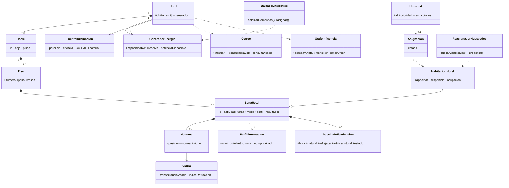

# Arquitectura del sistema educativo de iluminación hotelera

## 1. Propósito

Este documento define la arquitectura conceptual de un sistema educativo para analizar la iluminación de un hotel de dos torres en Bogotá. El sistema aplica árboles jerárquicos, un Octree, un grafo dirigido ponderado y recorridos de agregación para estudiar cuatro actividades: habitaciones, cocina, recreación y parqueadero.

El modelo cubre 24 horas con un único flujo de simulación. Durante el día combina luz natural, transmisión por ventanas, reflexión y luz artificial complementaria. Durante la noche toma la componente solar como cero y utiliza principalmente las luminarias alimentadas por el generador. El resultado es un diagnóstico educativo, no un diseño fotométrico, eléctrico o arquitectónico profesional.

## 2. Decisiones arquitectónicas

### 2.1 Escenario fijo y reproducible

El hotel contiene exactamente dos torres:

```text
Hotel
├── TorrePequena: 4 pisos, 32 habitaciones, 4 cocinas, 4 recreaciones, 1 parqueadero
└── TorreGrande: 6 pisos, 72 habitaciones, 6 cocinas, 6 recreaciones, 2 parqueaderos
```

Las áreas de referencia son aproximadamente 4.013 m² y 11.346 m², inspiradas en modelos comerciales del DOE. Las cajas, posiciones, zonas, luminarias y huéspedes son datos sintéticos didácticos; no son un plano real de Bogotá.

La caja de `TorrePequena` es `x=0..32, y=0..31.35, z=0..12`. La caja de `TorreGrande` es `x=45..89, y=0..43, z=0..18`. Cada piso tiene 3 m de altura y la separación horizontal entre torres es de 13 m.

### 2.2 Un árbol físico, tres estructuras auxiliares

```text
Árbol jerárquico:
    Hotel → Torre → Piso → ZonaHotel → Ventana

Octree:
    cajas de torres, paredes, ventanas, zonas y luminarias

Grafo de influencia:
    Superficie/Fuente → Ventana/ZonaHotel
```

El árbol representa composición física y lógica. El Octree sólo acelera consultas espaciales. El grafo representa aportes lumínicos aproximados y no reemplaza la jerarquía.

### 2.3 Modelo único de día y noche

No se crean clases `ResultadoDiurno` ni `ResultadoNocturno`. Las mismas clases `ZonaHotel`, `PerfilIluminacion`, `ResultadoIluminacion`, `EvaluadorHabitabilidad` y `BalanceEnergetico` reciben el instante y el modo de operación.

```text
E_total(z,t) = E_natural(z,t) + E_reflejada(z,t) + E_artificial(z,t)

Día:   E_natural + E_reflejada + E_artificial
Noche: 0 + 0 + E_artificial
```

Los modos son `ACTIVA`, `REDUCIDA`, `CERRADA` y `EMERGENCIA`. Una habitación en descanso se compara con un nivel reducido configurable, no con el perfil de habitación activa.

### 2.4 Diagnóstico, no optimización

El sistema no modifica las torres, las ventanas, las paredes ni la capacidad del hotel. El balance de energía y la reasignación de huéspedes son heurísticos. Una reasignación cambia una relación `Huesped–HabitacionHotel`; no mueve físicamente al huésped ni modifica la geometría.

## 3. Datos sintéticos comunes

| Elemento | TorrePequena | TorreGrande | Regla común |
|---|---:|---:|---|
| Pisos | 4 | 6 | 3 m por piso |
| Habitaciones | 32 | 72 | 24 m², capacidad 2 |
| Cocinas | 4 | 6 | 35 m² |
| Recreaciones | 4 | 6 | 80 m² |
| Parqueaderos | 1 | 2 | 450 m² |
| Habitaciones ocupadas | 24 | 54 | 78 huéspedes en total |
| Ventanas | 52 | 102 | Habitaciones 1, cocinas 2, recreaciones 3 |

Cada habitación tiene una ventana de 2,0 m²; cada cocina tiene dos de 1,5 m² y cada recreación tres de 2,0 m². Los IDs siguen los patrones `TP-H-101`, `TG-H-101` y `H-001` a `H-078`. Las orientaciones de habitaciones alternan norte, este, sur y oeste.

Las luminarias equivalentes por zona son: habitación 72 W, cocina 200 W, recreación 450 W y parqueadero 720 W. Todas usan, como supuesto didáctico, 100 lm/W, `CU=0,70` y `MF=0,80`. El generador nominal es de 22,0 kW y sólo alimenta iluminación.

| Actividad | Horario sintético | Perfil activo | Prioridad |
|---|---|---:|---:|
| Habitación | 06:00–22:00 activa; resto reducida | 100–200–300 lux | 3 |
| Cocina | 06:00–22:00 activa; resto reducida | 300–400–500 lux | 3 |
| Recreación | 08:00–23:00 activa; resto reducida | 200–300–500 lux | 2 |
| Parqueadero | 00:00–24:00 activa | 50–100–150 lux | 1 |

Los tripletes significan mínimo–objetivo–máximo. Son presets de cálculo, no valores normativos textuales.

## 4. Contraste con RETILAP

La página oficial del Ministerio de Minas y Energía informa que el RETILAP vigente fue modificado por la Resolución 40286 del 23 de junio de 2026 y que está organizado en cuatro libros. La misma página describe una herramienta de apoyo para habitaciones, cocinas y otras áreas, pero no presenta una tabla única que permita afirmar que los cuatro tripletes anteriores sean una transcripción normativa directa.

Por ello, la arquitectura adopta esta regla: los rangos sirven para el escenario educativo y deben confirmarse en el diseño final contra la categoría exacta de actividad, plano de trabajo, uniformidad, deslumbramiento y mantenimiento. El modo `EMERGENCIA` tiene un parámetro independiente y no se deduce de los rangos normales. Fuente oficial: [RETILAP, Ministerio de Minas y Energía](https://www.minenergia.gov.co/es/misional/energia-electrica-2/reglamentos-tecnicos/reglamento-t%C3%A9cnico-de-iluminaci%C3%B3n-y-alumbrado-p%C3%BAblico-retilap/).

## 5. Clases del dominio

### `Hotel`

Contiene exactamente dos `Torre`, un `GeneradorEnergia`, perfiles climáticos, superficies, fuentes y asignaciones de huéspedes.

### `Torre`

Mantiene ID, caja espacial, área de referencia, pisos y superficies. Sus dimensiones son fijas.

### `Piso`

Mantiene número, peso `1 + 0,10(p-1)` y zonas del piso.

### `ZonaHotel`

Mantiene ID, actividad, área, modo, perfil, ventanas, reflectancia, luminarias y resultados temporales. Puede representar una `HabitacionHotel`, cocina, recreación o parqueadero.

### `HabitacionHotel`, `Huesped` y `Asignacion`

`HabitacionHotel` agrega capacidad, disponibilidad y ocupación. `Huesped` agrega actividad, prioridad y restricciones. `Asignacion` relaciona huésped y habitación y puede cambiar durante una propuesta de reasignación.

### `Ventana`, `Vidrio` y `SuperficiePared`

Una ventana mantiene posición, normal, área y vidrio. El vidrio mantiene transmitancia visible e índice de refracción. Una pared mantiene color nominal y reflectancia educativa.

### `FuenteIluminacion` y `GeneradorEnergia`

Una fuente mantiene posición, potencia, eficacia, `CU`, `MF`, horario y zona servida. El generador mantiene capacidad, reserva y potencia asignada. El generador no modela cargas de habitaciones, ascensores o climatización.

## 6. Clases algorítmicas

| Clase | Responsabilidad |
|---|---|
| `Octree` | Consultar rayos, radios y objetos espaciales candidatos. |
| `GrafoInfluencia` | Mantener aristas de reflexión de primer orden. |
| `PerfilClimatico` | Mantener irradiancia, nubosidad y precipitación de Bogotá. |
| `PerfilIluminacion` | Mantener mínimo, objetivo, máximo y prioridad. |
| `SimuladorUnificado` | Ejecutar el mismo flujo entre 00:00 y 24:00. |
| `BalanceEnergetico` | Cubrir mínimos y distribuir la potencia restante. |
| `EvaluadorHabitabilidad` | Clasificar zonas y calcular puntuaciones. |
| `ReasignadorHuespedes` | Buscar habitaciones disponibles compatibles. |

## 7. Reglas de cálculo

La luz artificial se aproxima con el método de lúmenes:

```text
E_artificial = eficacia × potenciaAsignada × CU × MF / área
```

El generador se dimensiona sólo para iluminación:

```text
P_generador = 1,20 × máximo_t(suma(P_obj(z,t)))
```

El balance primero garantiza mínimos de seguridad y de habitaciones ocupadas; después ordena las demandas por `pesoActividad × pesoPiso × factorOcupacion`. El peso no modifica el estado físico de una zona: una zona oscura sigue siendo deficitaria.

La clasificación por instante es:

```text
E < 0,50 mínimo       → DEFICIT_SEVERO
0,50 mínimo ≤ E < min → DEFICIT_LEVE
mínimo ≤ E ≤ máximo   → CONFORTABLE
máximo < E ≤ 1,25 max → EXCESO_LEVE
E > 1,25 máximo       → EXCESO_SEVERO
faltan datos           → DATOS_INSUFICIENTES
```

La reflexión se limita a primer orden. El vidrio usa una transmitancia visible de 0,82, 0,70–0,72 o 0,52 según el preset y Snell con índice cercano a 1,5. Las paredes usan reflectancias educativas de 0,80, 0,70, 0,60, 0,45 o 0,25.

## 8. Diagrama de clases conceptual



## 9. Flujo de ejecución

1. Validar que existan exactamente dos torres y cargar el dataset sintético.
2. Crear pisos, zonas, superficies, ventanas, vidrios y fuentes.
3. Cargar el perfil de Bogotá y los horarios de las cuatro actividades.
4. Insertar cajas y posiciones en el Octree.
5. Construir aristas de influencia por distancia, orientación y visibilidad.
6. Recorrer los instantes de 00:00 a 24:00.
7. Calcular sol, clima, sombra, transmisión, refracción y reflexión cuando corresponda.
8. Calcular demanda mínima y objetivo.
9. Asignar primero mínimos y luego potencia restante.
10. Clasificar cada zona y guardar `ResultadoIluminacion`.
11. Revisar habitaciones ocupadas con déficit.
12. Buscar alternativas y generar recomendaciones de reasignación.
13. Exportar estados, puntuaciones, energía y déficits residuales.

## 10. Complejidad conceptual

| Operación | Coste aproximado |
|---|---|
| Comparar todas las ventanas con todas las torres | `O(V × B × T)` |
| Consulta espacial esperada | `O(log B + k)` |
| Simulación con Octree | `O(V × T × (log B + k))` |
| Construcción ingenua del grafo | `O(S²)` |
| Grafo espacial disperso | `O(S log S + E)` |
| Agregación por árbol | `O(N)` |
| Balance por instante | `O(Z log Z)` por ordenamiento de demandas |

Estas expresiones son aproximadas y dependen de la distribución espacial y del número de candidatos.

## 11. Límites

No se incluyen mallas complejas, óptica espectral, deslumbramiento profesional, consumo total del hotel, optimización global, reservas reales ni ejecución automática de traslados. El documento separa fuentes publicadas, presets educativos y datos sintéticos para evitar confundirlos.
